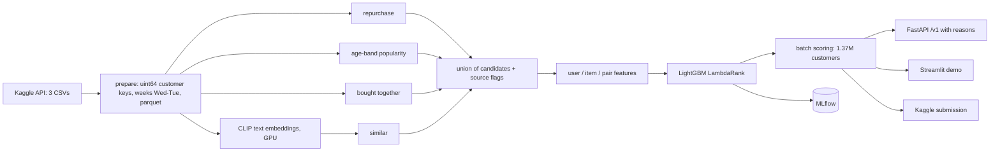

# H&M fashion recommender: two-stage, end to end

Personalised top-12 recommendations for **1.37M customers** from **31.8M purchases** of 105k articles
(the [H&M Personalized Fashion Recommendations](https://www.kaggle.com/competitions/h-and-m-personalized-fashion-recommendations)
dataset). It's built the way production recommenders are:

- **Stage 1, candidate generation:** four sources, each explaining *why* it suggests an item:
  - **repurchase**: the customer's own recent purchases;
  - **popular**: last week's best sellers in the customer's age band;
  - **bought together**: items bought in the same week as the customer's recent purchases;
  - **similar**: nearest neighbours in **CLIP** embedding space, computed on the GPU.
- **Stage 2, ranking:** a **LightGBM LambdaRank** model with user, item and user-item features.
- **Evaluation:** the competition's **MAP@12**, on a held-out week, against two baselines. Leakage and
  determinism are tested.
- **Serving and operations:**
  - batch scoring of every customer;
  - a **FastAPI** service that explains each recommendation;
  - a **Streamlit** demo with product photos;
  - weekly drift monitoring, **MLflow** tracking, **Docker** and **CI**.

## Results

MAP@12 on validation week 2020-09-16 to 2020-09-22, across the 68,984 customers who bought something
that week (higher is better):

| Model | MAP@12 |
|---|---:|
| **Two-stage: 4 candidate sources + LightGBM LambdaRank** | **0.03278** |
| Repurchase, then age-band popularity (heuristic) | 0.02600 |
| Global top-12 of last week | 0.00898 |

**Kaggle late submission:** private-leaderboard MAP@12 **0.02757** (public 0.02741) on the competition's
hidden test week (2020-09-23 to 2020-09-29), submitted 2026-11-15 with `scripts/kaggle_submit.py`. It is
lower than the validation score because the test week is a different, unseen week.

The ranker is **26.1% better** than the best baseline on the validation week. Stage 1 surfaces **16.0%** of the purchases
actually made that week, from about 182 candidates per customer. That recall is the ceiling the ranker
works under.

**What CLIP adds, honestly:** the same pipeline without the CLIP source scored 0.03267 (MLflow run
`a03f40ed…`). The gain from text-only CLIP similarity (+0.0001) is within LightGBM's run-to-run
variation (about ±0.0002). On its own CLIP surfaces 1.8% of purchases, but adding it raises combined
candidate recall only from 15.5% to 16.0%.

All numbers come from MLflow runs; the full tables, with run ids, are in [RESULTS.md](RESULTS.md),
generated by `python -m hmrec.report`.

## Architecture



**No leakage, tested.** Candidates and features for target week *W* only use purchases from before *W*.
`tests/test_candidates.py` scrambles week *W* and every later week inside the full dataset, and checks
that the features don't change.

**Memory.** Each 64-character customer hash becomes a 64-bit integer (collision-checked), and
transactions become typed parquet. 31.8M rows take 214 MB on disk and fit easily in 12 GB of RAM.
Validation scoring runs in float32 chunks.

## Quick start

Needs Python 3.12 and [uv](https://docs.astral.sh/uv/). The Kaggle data needs an API token, and the
competition rules must be accepted on kaggle.com.

```bash
uv sync --extra train --extra dashboard --extra embed  # embed = CUDA PyTorch + transformers (CLIP)
uv run python scripts/download_data.py                 # the 3 CSVs (~3.7 GB), not the 28.7 GB photo archive
uv run python -m hmrec.data.prepare                    # -> data/interim/*.parquet
uv run python -m hmrec.embed                           # CLIP text embeddings (about 90 s on an RTX 3050)
uv run python -m hmrec.train                           # validation + final model + scoring everyone
uv run python -m hmrec.report                          # RESULTS.md from MLflow
uv run python -m hmrec.monitoring                      # drift report + retrain flag
uv run python scripts/download_data.py --images 400    # photos for the demo's articles only
uv run uvicorn hmrec.serve.api:app --port 8010         # http://localhost:8010/docs
uv run streamlit run app/dashboard.py                  # demo
```

On a laptop (i5-12450HX, 11.7 GB RAM, RTX 3050 6 GB), the full `train` run takes about 36 minutes. Most
of that is scoring all 1.37M customers.

Docker (API + demo; the serving bundle and thumbnails are mounted read-only): `docker compose up --build`.

## API

Base URL `http://localhost:8010`. Read-only, no auth. Interactive docs are at `/docs`.

| Method | Path | Returns |
|---|---|---|
| GET | `/v1/model` | validation MAP@12 for each model, candidate recall, MLflow run ids |
| GET | `/v1/customers?limit=&offset=` | demo customers (paginated, `limit` ≤ 100) |
| GET | `/v1/customers/{id}/recommendations?k=1..12` | ranked items with `reasons` and a plain-English explanation |
| GET | `/v1/customers/{id}/purchases?limit=` | recent purchases (demo customers) |
| GET | `/v1/articles/{id}` | article details |
| GET | `/v1/articles/{id}/similar?k=1..12` | CLIP nearest neighbours |
| GET | `/v1/articles/{id}/image` | thumbnail (JPEG) |

Every error uses the same shape, `{"error": {"code", "message", "details"}}`. The codes are
`customer_not_found`, `article_not_found`, `history_not_available`, `image_not_available`,
`validation_error` and `unknown_query_parameter`.

## Choices worth knowing

- **Text-only CLIP.** The photo archive is 28.7 GB, which was impractical to download here, so CLIP
  embeds each article's name, type, colour, pattern and description. `python -m hmrec.embed --images`
  adds the image encoder when thumbnails are available.
- **Weeks run Wednesday to Tuesday**, aligned with the competition's hidden test week (2020-09-23 to
  2020-09-29), so the validation week matches the real test setup.
- **Active catalogue only.** Only articles sold in the last 4 weeks are recommended, because dead stock
  wastes slots.
- **Negative sampling.** Training keeps every positive and 25% of the negatives, and only uses customers
  with at least one positive candidate.

## Data and licence

The competition data is **not** in this repository. It may only be used for non-commercial and academic
purposes under the competition rules, so download it with your own Kaggle account. The code is
MIT-licensed. Model card: [MODEL_CARD.md](MODEL_CARD.md).
